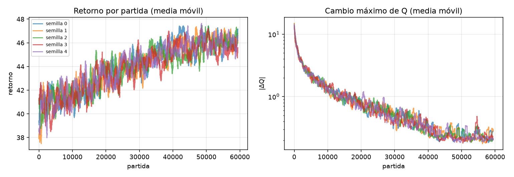
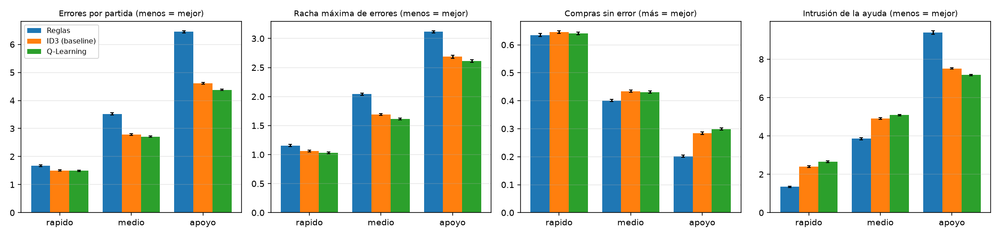
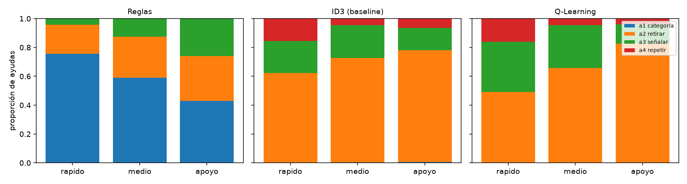

# PictoMarket — Informe técnico

> Estructura del §10 del enunciado (1ASI0404, 2026-20). Las cifras de la sección II salen de `datos/simulaciones/` y se regeneran con `python experimentos/entrenar_y_evaluar.py` (≈ 5 min, semillas fijas). Los apartados marcados **[Completar con el equipo]** requieren evidencia que solo el equipo posee y no se inventa.

## I. Introducción y objetivos

**Solución.** PictoMarket es un juego de compras con pictogramas ARASAAC para personas con discapacidad intelectual de la Asociación Educativa Kallpa. La guía, Inti, formula la consulta como una **frase de pictogramas** (`[BUSCAR] + [PECHUGA DE POLLO]`), reforzada con texto y voz. Ante cada error, un agente elige qué ayuda dar hasta completar la compra: pista de categoría, retirar un distractor, señalar el producto o repetir la consulta sin escalar. Corresponde a la Modalidad 1 del enunciado: el agente inicia.

**ODS.**
- *ODS 10:* herramienta de ocio y aprendizaje autónomo basada en pictogramas, que no depende del texto escrito.
- *ODS 4:* estimula vocabulario cotidiano, categorización funcional y resolución de problemas, con apoyo adaptado al ritmo de cada persona.

**Justificación técnica.**
- **Punto de partida:** una política de reglas fija (a1 → a2 → a3) que ayuda igual a todos.
- **Baseline ID3:** entropía y ganancia de información.
- **Modelo principal:** aprendizaje de valores de acción (Q) con retorno Monte-Carlo. Su estado incluye un perfil estimado del jugador, la última ayuda y si hay un distractor «confusor» de la misma categoría, para dar la ayuda mínima que evite errores en cadena.
- **Sin visión computacional** (es opcional en el enunciado): la interacción es digital estructurada, por toques sobre pictogramas, lo que reduce barreras de hardware en los centros.

## II. Metodología y modelado del agente

**Entorno y reglas.** Estados, acciones, transición, recompensa y victoria están en `docs/formalizacion.md`.

**Catálogo y escenarios.**
- 30 pictogramas de productos y 2 escenarios preconfigurados (`datos/escenarios.json`).
- 9 pictogramas de función para las frases (`datos/pictogramas_funcion.json`), elegidos con la API pública de ARASAAC.
- Todos son de ARASAAC (Sergio Palao, Gobierno de Aragón, licencia CC BY-NC-SA).

**Captura.** Eventos de la interfaz: el toque sobre un producto y su tiempo de respuesta. No hay visión computacional ni *data augmentation*.

### Rediseño de la recompensa

La primera versión castigaba más una pista (−3 por nivel) que un error (−1 por turno). El agente aprendió a **no ayudar**: repetía la consulta, y los jugadores simulados cometían más errores y necesitaban más turnos que con las reglas. Para este público, encadenar errores produce frustración. La práctica recomendada es el **aprendizaje sin errores** con ayudas **de menor a mayor intrusión**.

La versión 2 refleja esos principios:

| Elemento | Valor | Motivo |
|---|---|---|
| Error tras `f` fallos seguidos | −(2 + 2·min(f, 3)) | la frustración crece con la racha |
| Intrusión de la ayuda | `a4` 0 · `a1` −0,5 · `a2` −1,5 · `a3` −3 | preferir la ayuda mínima que funcione |
| Repetir `a1` o `a4` seguidas | −3 | no aportan información nueva |
| Compra | +10; +3 si fue sin errores | progreso y autonomía |
| Completar / tope de turnos | +20 / −10 | objetivo de la partida |

Cambiar solo la recompensa no bastó: la política aprendida pasó a **señalar en el 70–90 % de las ayudas**, es decir, regalaba la respuesta. El diagnóstico (simulaciones desde las mismas decisiones) mostró tres causas, cada una con su corrección:

1. **El simulador no modelaba la dependencia de la ayuda.** Se añadió una dinámica de confianza: comprar sin pista o con una pista leve la sube, que le señalen el producto la baja. Es un supuesto, y se evalúa su robustez más abajo.
2. **El estado no distinguía cuándo sirve la pista de categoría.** Se añadió `c`: hay un distractor visible de la misma categoría que el objetivo.
3. **El objetivo de un paso estaba sesgado.** El perfil del jugador solo se estima, así que distintas situaciones se ven como el mismo estado; estimar el valor a partir del estado siguiente arrastraba ese error. Se pasó a usar el **retorno completo de la partida** (Monte-Carlo), con `γ = 1` y paso `α = max(0,02; N^−0,6)`.

### Entrenamiento

60 000 partidas por semilla, con 5 semillas. El retorno medio sube de ≈ 40 en las primeras 2 000 partidas a ≈ 46 en las últimas 2 000, en las 5 semillas por igual. El cambio de Q decrece de forma sostenida (escala logarítmica en la figura).

**ID3 (baseline).**
- Datos de entrenamiento: 119 estados etiquetados con la mejor ayuda según simulaciones Monte-Carlo, con continuación por reglas.
- Exactitud en validación (30 %): **0,78**, frente a 0,58 de la clase mayoritaria.
- Variable de la raíz del árbol: productos que faltan.

### Evaluación

30 semillas de evaluación, distintas a las de entrenamiento × 200 partidas × 2 escenarios por perfil. Media ± IC 95 %. Éxito = 100 % en todas las políticas.

| Perfil | Política | Errores | Racha máx. | Compras sin error | Intrusión | Turnos |
|---|---|---|---|---|---|---|
| apoyo | reglas | 6,45 ± 0,04 | 3,12 | 0,202 | 9,40 | 9,95 |
| apoyo | ID3 | 4,61 ± 0,03 | 2,69 | 0,284 | 7,52 | 8,11 |
| apoyo | **Q-Learning** | **4,38 ± 0,03** | **2,61** | **0,299** | **7,18** | **7,88** |
| medio | reglas | 3,52 ± 0,04 | 2,04 | 0,401 | 3,85 | 7,02 |
| medio | ID3 | 2,79 ± 0,03 | 1,69 | 0,434 | 4,91 | 6,29 |
| medio | **Q-Learning** | **2,71 ± 0,03** | **1,61** | 0,431 | 5,08 | **6,21** |
| rápido | reglas | 1,67 ± 0,03 | 1,16 | 0,635 | **1,35** | 5,17 |
| rápido | ID3 | 1,50 ± 0,02 | 1,06 | **0,646** | 2,40 | 5,00 |
| rápido | **Q-Learning** | **1,49 ± 0,02** | **1,03** | 0,641 | 2,65 | **4,99** |

**Diferencias pareadas, Q-Learning − reglas** (mismas semillas; `datos/simulaciones/diferencias_pareadas.csv`):

| Perfil | Errores | Compras sin error | Intrusión |
|---|---|---|---|
| apoyo | **−2,07 ± 0,04 (−32 %)** | **+9,7 ± 0,5 puntos** | **−2,22 ± 0,09 (−24 %)** |
| medio | −0,81 ± 0,03 (−23 %) | +3,0 ± 0,3 puntos | +1,23 ± 0,05 |
| rápido | −0,18 ± 0,01 (−11 %) | +0,6 ± 0,2 puntos | +1,30 ± 0,03 |

Frente al baseline ID3, Q-Learning comete menos errores en los tres perfiles: −0,23, −0,08 y −0,01, todas diferencias significativas.
- En «apoyo» además es menos intrusivo y logra más compras sin error.
- En «medio» y «rápido» queda empatado o ligeramente por debajo en autonomía y retorno.

**Adaptación por perfil.** Con jugadores que necesitan apoyo, el agente usa sobre todo **retirar un distractor** (82 % de las ayudas). Con jugadores rápidos lo combina con señalar (35 %) y repetir la consulta (16 %). Las reglas, en cambio, usan sobre todo la pista de categoría (43–76 %). En este simulador esa pista ayuda poco, porque el distractor que confunde suele ser de la misma categoría.

**Ablación** (`ablacion_qlearning.csv`; 20 000 partidas, media de los tres perfiles):

| Objetivo | γ | Errores | Compras sin error | Intrusión | % señalar |
|---|---|---|---|---|---|
| un paso (TD) | 0,95 | 2,82 | 0,387 | 6,63 | 76 % |
| un paso (TD) | 1 | 2,82 | 0,387 | 6,79 | 80 % |
| Monte-Carlo | 0,95 | 2,85 | 0,437 | 5,67 | 42 % |
| Monte-Carlo | 1 | 3,07 | 0,404 | 5,70 | 50 % |

El objetivo Monte-Carlo **reduce casi a la mitad el uso de «señalar»** y sube la autonomía, con errores similares. El efecto de γ no es concluyente con 20 000 partidas. Con 60 000 partidas (la configuración final, evaluada con 30 semillas), MC con γ = 1 llega a la mayor autonomía (0,457) y a la menor intrusión (4,97) de la tabla. Sus errores (2,86) son similares a los de TD (2,82). La comparación es aproximada, porque la ablación usa 5 semillas de evaluación.

**Robustez** (`robustez_sin_aprendizaje.csv`). Si se quita la dinámica de confianza del simulador:
- Q-Learning sigue cometiendo menos errores que las reglas en los tres perfiles: 4,41 contra 6,47 en «apoyo», 2,79 contra 3,77 en «medio» y 1,62 contra 1,91 en «rápido».
- La ganancia de autonomía se mantiene en «apoyo» (+9 puntos) y se reduce en los demás perfiles.

La conclusión principal (menos errores y menos frustración) no depende de ese supuesto.

**Lectura honesta.**
- La mejora es clara en el público objetivo («apoyo»: −32 % de errores, menos intrusión, más autonomía).
- En jugadores rápidos, el agente reduce poco los errores y es **más intrusivo** que las reglas (2,65 contra 1,35). Con las reglas, los jugadores rápidos obtienen un retorno levemente mayor (56,0 contra 55,6).
- La pista de categoría casi no se usa. Es una consecuencia del modelo del simulador, y debe validarse con terapeutas.
- Todo depende de la recompensa (decisión de diseño) y de un usuario simulado, no de personas reales.

**Casos de borde probados** (`codigo/ia_models/tests/`, 34 pruebas):
- Estados nunca vistos: caen a las reglas.
- `a2` sin distractor removible: equivale a `a3`.
- Toques repetidos o sobre productos ya comprados: se ignoran.
- Tope de turnos y reproducibilidad por semilla.
- Coste creciente de las rachas de error, y penalización solo de las repeticiones sin información nueva.
- Paridad Python ↔ TypeScript: 12 partidas con todas las políticas.

## III. Desarrollo del software y accesibilidad

**Arquitectura.**
1. Interfaz React: toque sobre pictogramas.
2. Motor del juego: `game.ts`.
3. Política de ayuda: `policy.ts` interpreta los JSON exportados, sin servidor.
4. Respuesta: frase de pictogramas (`PictoSentence`), texto, voz y resaltado en pantalla.

El entrenamiento y la evaluación están en Python (`codigo/ia_models`). La API de referencia es opcional (`codigo/backend`). El terapeuta elige la política en el panel; Q-Learning es la predeterminada.

**Diseño accesible (CAA).**
- Consultas y ayudas como secuencias de pictogramas grandes, por ejemplo `[MIRAR] + [AQUÍ] + [producto]` o `[OTRA VEZ] + [BUSCAR] + [producto]`.
- Alto contraste, objetivos táctiles ≥ 44 px y textos cortos.
- Voz que nunca se activa sola. Hoy es la voz del navegador; la mejora con ElevenLabs la desarrolla otro integrante del equipo.
- Foco gestionado y respeto de `prefers-reduced-motion`.
- Presentación guiada por Inti sobre la propia pantalla de juego, que se repite con el botón «Guía».

**Despliegue.** Ver `README.md` y `codigo/frontend/README.md`. **[Completar con el equipo: URL desplegada.]**

## IV. Resultados y conclusiones

**Impacto social en Kallpa.** **[Completar con el equipo]** con la evidencia de usabilidad real (ver `docs/metodologia/usabilidad-protocolo.md`). Hasta contar con ella, el impacto solo puede describirse como *potencial*. En simulación, el agente reduce un tercio los errores de quienes más apoyo necesitan, con ayudas menos intrusivas, y comunica todo con pictogramas.

**Limitaciones.**
1. Evaluación solo con jugadores simulados; la dinámica de confianza es un supuesto.
2. Recompensa elegida por diseño. Debe calibrarse con terapeutas.
3. Más intrusión que las reglas con jugadores rápidos.
4. Q tabular con perfil estimado de 3 niveles.
5. Dos escenarios.
6. Sin visión computacional.

**Trabajo futuro.**
- Calibrar los costes de la recompensa con terapeutas.
- Validar con usuarios reales.
- Separar la política por perfil confirmado por el terapeuta.
- Más escenarios y niveles.
- Voz realista.

## V. Anexos

- Repositorio: **[Completar: enlace]**.
- Video demostrativo (3 a 5 min): **[Completar: enlace]**.
